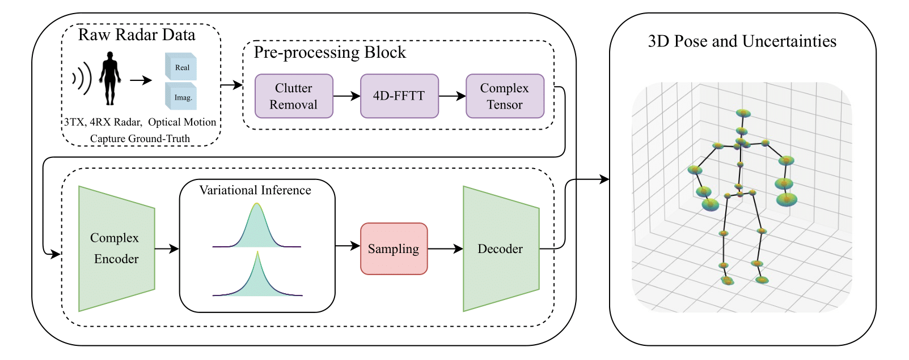

# RadProPoser: Probabilistic Radar Tensor Human Pose Estimation That Knows Its Limits

<div align="center">
  
</div>

## Folder Structure
The folder structure of this repository is organized as follows:

```
RadProPoser/
├── data/
│   └── raw_radar_data/              # Our dataset (radar + skeletons)
├── models/                           # Neural network architectures
│   ├── common.py                     # Shared: HRNet backbone, ResidualMLP
│   ├── radproposer_vae.py            # RadProPoserVAE (Gaussian/Laplace latent)
│   ├── radproposer_vae_cov.py        # RadProPoserVAECov (full covariance)
│   ├── ho_single_frame.py            # HRRadarPose (Ho et al. baseline)
│   ├── evidential_pose_regression.py # RadProPoserEvidential (evidential DL)
│   ├── normalizing_flow.py           # RadProPoserVAENF (normalizing flow)
│   ├── transformer.py                # Transformer for temporal aggregation
│   ├── hrnet3D_config.py             # HRNet architecture configs
│   └── hrnet3D_config_4D.py          # HRNet configs for 4D (single-frame) models
├── tools/                            # Training, testing, calibration scripts
│   ├── config.py                     # Central configuration + MODEL_REGISTRY
│   ├── train_script.py               # Training entry point
│   ├── train_loop.py                 # Training loop, checkpoint I/O
│   ├── testing.py                    # Test set evaluation
│   ├── losses.py                     # Loss functions (NLL, KL, Laplace)
│   ├── data_loaders.py              # Dataset and data loading
│   ├── calibration_test.py           # Recalibration entry point
│   ├── calibration_analysis.py       # Parametric recalibration
│   ├── calibration_analysis_empirical.py  # Empirical recalibration
│   └── inference_time.py             # Inference benchmarking
├── trainedModels/                    # Pretrained model weights
├── HuPR-.../                         # HuPR dataset experiments
│   ├── config.py                     # Central configuration
│   ├── train.py                      # RadProPoserVAECov training
│   ├── test.py                       # Testing with uncertainty metrics
│   ├── models/                       # Model architectures
│   ├── datasets/                     # Data loaders
│   ├── preprocessing/                # Radar processing, 3D GT generation
│   ├── scripts/                      # Inference and evaluation
│   ├── misc/                         # Losses, metrics, utilities
│   ├── recalibration/                # Uncertainty recalibration
│   └── MotionBERT/                   # 2D-to-3D lifting model
├── LICENSE.txt
└── requirements.txt
```

---

## Installation
A working installation of CUDA should be provided if GPU should be used. We used python 3.12 for the analysis.
To get started with the project, follow the steps below:

1. **Set up a virtual environment**:
   ```bash
   python -m venv venv
   source venv/bin/activate
   ```

2. **Install torch with cuda_12.4**:
   ```bash
   pip install torch torchvision torchaudio
   ```

3. **Install additional dependencies**:
   ```bash
   pip install -r requirements.txt
   ```

4. **Download data**:
   Our data can be downloaded anonymously here: https://doi.org/10.5281/zenodo.14035103. Place our dataset in the `data/` folder.

> **Note on the dataset format:** The radar cubes in the Zenodo archive (`data_cube_parsed_*.npz`, shape `(frames, azimuth=4, elevation=4, range=64, chirps=128)`) are stored with the **range FFT already applied** along the range axis. The models in this repository expect raw ADC data, because the full 4D FFT is part of every forward pass by design. The data loader therefore applies an inverse FFT along the range axis (`np.fft.ifft(radar, axis=-2)` in `tools/data_loaders.py`) when generating training sequences, which exactly restores the raw fast-time samples — the stored spectrum is unwindowed and unnormalized, so this inversion is lossless. No manual preprocessing is required. If you use the dataset in your own pipeline, be aware of the pre-applied range FFT; and if you generated training sequences with an earlier version of this code, delete the generated `train`/`val`/`test` folders so they are rebuilt with the corrected data.

---

## Radar-based Human Pose Estimation

### 1. Configuration
Before training or testing, configure the model in `tools/config.py`:
- Set `MODEL_NAME` to the model you want to train. default is the best performing model as described in the paper
- Set `PATH_ORIGIN` to your data root path
- Set `PATH_RAW` to your raw radar data path

The dataloader currently includes all training participants, including the original validation participant, because the hyperparameters are already optimized and we aim for maximum performance on the held-out test set. If you want to tune your own hyperparameters, remove the validation participant from the training set to restore a proper validation split and track generalization each epoch.

### 2. Training
The training data (unfolded sequences) is automatically generated based on specified parameters and directories in `config.py`. Around 1.7 to 2 TB of free disk space should be available. The model is trained using Weights and Biases (wandb). You need to create a wandb account.

Create data and train the model:
```bash
python tools/train_script.py
```

### 3. Testing
Run evaluation on the test set. Results are saved to `tools/calibration_analysis/`:
```bash
python tools/testing.py
```

### 4. Calibration Analysis and Recalibration
After testing, run recalibration analysis. This fits recalibration models on validation data (p1) and evaluates on test data (p2, p12). Results and plots are saved to `tools/calibration_plots/` and `tools/calibrated_models/`:
```bash
python tools/calibration_test.py
```

---

## HuPR Dataset Experiments

This section describes how to reproduce our experiments on the HuPR dataset. All scripts are in the `HuPR-A-Benchmark-for-Human-Pose-Estimation-Using-Millimeter-Wave-Radar/` directory.

### 1. Configuration
Configure paths in `HuPR-A-Benchmark-for-Human-Pose-Estimation-Using-Millimeter-Wave-Radar/config.py`:
- Set `DATA_DIR` to your HuPR data directory (download from [HuPR GitHub](https://github.com/robert80203/HuPR-A-Benchmark-for-Human-Pose-Estimation-Using-Millimeter-Wave-Radar))

### 2. MotionBERT Setup
The 3D ground truth generation and 2D-to-3D lifting steps require the [MotionBERT](https://github.com/Walter0807/MotionBERT) library and pretrained weights:
1. Clone the MotionBERT repository and copy its `lib/` directory into `HuPR-.../MotionBERT/`:
   ```bash
   git clone https://github.com/Walter0807/MotionBERT.git /tmp/MotionBERT
   cp -r /tmp/MotionBERT/lib HuPR-A-Benchmark-for-Human-Pose-Estimation-Using-Millimeter-Wave-Radar/MotionBERT/lib
   ```
2. Download the MotionBERT pretrained checkpoint (`FT_MB_release_MB_ft_h36m`) from the [MotionBERT releases](https://github.com/Walter0807/MotionBERT/releases) and place it at:
   ```
   HuPR-.../MotionBERT/checkpoint/pose3d/FT_MB_release_MB_ft_h36m/best_epoch.bin
   ```

### 3. Data Preparation
Process the raw radar data and generate 3D ground truth annotations:
```bash
cd HuPR-A-Benchmark-for-Human-Pose-Estimation-Using-Millimeter-Wave-Radar

# Process raw radar ADC data to 4D tensors
python preprocessing/process_full_radar.py

# Generate MotionBERT 3D pose annotations from 2D keypoints
python preprocessing/generate_3d_gt.py
```

### 4. Training
Train the RadProPoserVAECov model on HuPR radar data:
```bash
python train.py
```
Checkpoints are saved to `checkpoints/`. Training uses Weights and Biases (wandb) for logging.

### 5. Testing
Evaluate the trained model with MPJPE, PA-MPJPE, Sharpness, and ECE metrics:
```bash
python test.py
```

### 6. Recalibration
Run uncertainty recalibration on the trained model:
```bash
python scripts/recalibrate.py
```

### 7. HuPR 2D-to-3D Lifting Baseline
To evaluate the HuPR model's 2D predictions lifted to 3D (baseline comparison), you need pretrained HuPR 2D weights. Either download them from [HuPR releases](https://github.com/robert80203/HuPR-A-Benchmark-for-Human-Pose-Estimation-Using-Millimeter-Wave-Radar/releases) and place at `logs/hupr_pretrained/model_best.pth`, or retrain from scratch with `python main.py --config mscsa_prgcn.yaml --dir hupr_pretrained`.

Then run inference and evaluation:
```bash
# Run HuPR 2D inference on test set
python scripts/run_hupr_inference.py

# Lift 2D predictions to 3D using MotionBERT
python scripts/lift_to_3d.py

# Evaluate 3D pose accuracy
python scripts/evaluate_3d.py
```

---

## License

This project is licensed under the [PolyForm Noncommercial License 1.0.0](https://polyformproject.org/licenses/noncommercial/1.0.0). You are free to use, share, and adapt this code for non-commercial purposes. See [LICENSE.txt](LICENSE.txt) for the full license text.

For commercial licensing inquiries, please contact the authors.

---

## Citation

If you find this work useful, please cite:

```bibtex
@article{mueller2025radproposer,
  title={RadProPoser: A Framework for Human Pose Estimation with Uncertainty Quantification from Raw Radar Data},
  author={Mueller, Jonas Leo and Engel, Lukas and Dorschky, Eva and Krauss, Daniel and Ullmann, Ingrid and Vossiek, Martin and Eskofier, Bjoern M},
  journal={arXiv preprint arXiv:2508.03578},
  year={2025}
}
```
